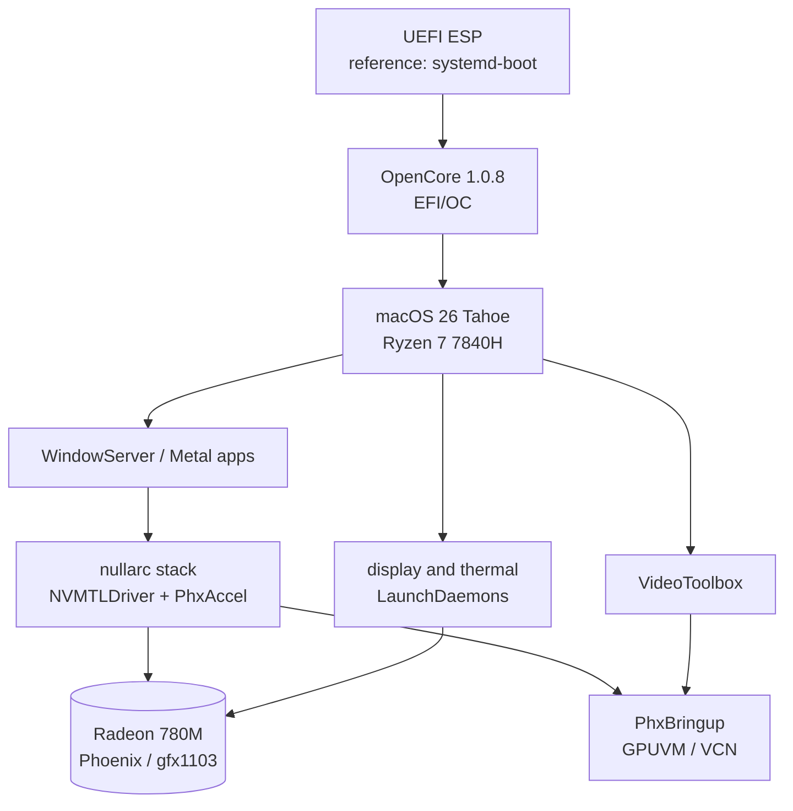

<p align="center">
  <b>MECHREVO Wujie S mini (F7BSC) · macOS 26 Hackintosh</b><br>
  OpenCore EFI, post-install tooling, driver patches and hardware-validated notes for<br>
  AMD Ryzen 7 7840H · Radeon 780M · Phoenix / RDNA 3 · macOS Tahoe 26.
</p>

<p align="center">
  <a href="README.md"><b>English</b></a> ·
  <a href="README.zh-CN.md">简体中文</a>
</p>

<p align="center">
  
  
  
  
  
  
  <a href="https://github.com/sfyyy/mechrevo-f7bsc-hackintosh/actions/workflows/docs.yml"></a>
  <a href="LICENSE"></a>
</p>

> [!IMPORTANT]
> **Developer preview (M1).** This repository is currently a same-model reference build, not a beginner-safe installer.
> It assumes an already installed macOS, an environment that can safely mount and write the EFI System Partition (ESP), external downloads, and the ability to recover from a failed boot. Arch Linux is not required; it was only the maintainer's reference environment.
> A clean, end-to-end installation for an ordinary user has **not yet been validated**. Read [docs/INSTALL.md](docs/INSTALL.md) before running any script.

## What this project is

This project documents and automates a practical macOS 26 Tahoe installation on one specific mini PC: the MECHREVO Wujie S mini **F7BSC**, equipped with a Ryzen 7 7840H and Radeon 780M. It combines an OpenCore EFI, post-install scripts, experimental GPU patches, thermal tuning, diagnostics, and evidence from real hardware.

The project is especially focused on the experimental [`nullarc`](https://github.com/luuumi-dev/nullarc) Radeon 780M stack: Metal, WindowServer GPU compositing, display stability fixes, and VideoToolbox/VCN media work.

## Goals

- Make the same F7BSC hardware reproducible from a clean, well-documented baseline.
- Keep GPU acceleration, display, thermal and media behavior measurable rather than anecdotal.
- Provide safe defaults, explicit rollback paths, and a validation checklist for every supported feature.
- Separate original project work from third-party binaries and clearly document their licenses.
- Eventually let an experienced same-model user install and recover without maintainer intervention.

**Non-goals:** universal Hackintosh EFI support, a zero-risk installer, support for unrelated laptops, or claims of production readiness.

## Feature status

| Area | State | Notes |
|---|---|---|
| OpenCore EFI | Working on F7BSC | OpenCore 1.0.8, macOS Tahoe boot path, placeholder SMBIOS values |
| CPU power management | Working | AMD Vanilla patch + AMDRyzenCPUPowerManagement with `ryzenidle=1` |
| Radeon 780M acceleration | Experimental | nullarc 0.4.0, Metal 3 and GPU-backed WindowServer compositing |
| Display stability | Experimental | Double-buffer and anti-ghosting LaunchDaemon patches; HDMI only |
| HDMI output | Working, limited | Firmware GOP mode 2560×1440@60; no HiDPI |
| Intel AX210 Wi-Fi | Working | AirportItlwm 2.4.0 |
| Intel AX210 Bluetooth | Experimental | Firmware/patcher installed; end-to-end status not fully recorded |
| Realtek RTL8125 Ethernet | Configured, unverified | Driver enabled but not independently validated |
| Realtek ALC269VB audio | Configured, unverified | AppleALC layout 11 + SimpleHDA; not independently validated |
| Thermal control | Experimental | GPU clock cap and clock-gating LaunchDaemon |
| H.264 encoding | Experimental | In-process VideoToolbox provider; not a general system-wide encoder |
| H.264 VCN decoding | Experimental | Build 75 benchmark: 41% less CPU at 1080p real-time; see [BENCHMARKS](macos/nullarc/nullarc-0.4.0-alpha/docs/vcn/BENCHMARKS.md) |
| HEVC hardware codec | Not implemented | No supported VCN HEVC path yet |
| Diagnostics and regression tests | Working | Status checks, VCN host tests, VideoToolbox and performance tools |

## Can I install from this repository?

| User and starting point | Support level | Current reality |
|---|---|---|
| F7BSC owner, advanced user, macOS already installed and ESP access available | **Experimental** | Follow the current guide with backups and recovery media; expect manual diagnosis |
| F7BSC owner performing a clean install from bare hardware | **Not yet supported** | BIOS settings, installer media creation and disk preparation are incomplete |
| Owner of a different laptop or mini PC | **Unsupported** | Do not reuse this EFI or these patches |
| Beginner without a second computer and recovery path | **Unsupported** | Wait for the M2/M3 milestones |

The documentation is considered mature only when a clean same-model installation succeeds end-to-end without maintainer intervention, including BIOS prerequisites, macOS installation, external files, validation, and rollback. That acceptance gate is tracked in [ROADMAP.md](ROADMAP.md).

## Architecture



## Repository layout

| Path | Purpose |
|---|---|
| [`EFI/`](EFI) | OpenCore EFI, ACPI tables, drivers and redistributable kexts |
| [`ACPI/`](ACPI) | Human-readable SSDT source files |
| [`linux/`](linux) | EFI deployment helpers; validated in the maintainer's Arch + systemd-boot setup, not Arch-specific by design |
| [`macos/display/`](macos/display) | Display stability LaunchDaemon and installer |
| [`macos/thermal/`](macos/thermal) | GPU clock-cap and clock-gating controls |
| [`macos/nullarc/`](macos/nullarc) | nullarc install wrappers (zip + patch flow) and the historical patches |
| [`macos/nullarc/nullarc-0.4.0-alpha/`](macos/nullarc/nullarc-0.4.0-alpha) | Our maintained nullarc source: PhxAccel, NVMTL, PhxBringup incl. VCN H.264 decode (build 82), decode plugin, install scripts, tests |
| [`macos/nullarc/nullarc-0.4.0-alpha/docs/vcn/`](macos/nullarc/nullarc-0.4.0-alpha/docs/vcn) | VCN/VideoToolbox validation, benchmarks and technical notes |
| [`macos/nullarc/nullarc-0.4.0-alpha/tools/perf/`](macos/nullarc/nullarc-0.4.0-alpha/tools/perf) | WindowServer, CoreAnimation and GPU profiling tools |
| [`macos/nullarc/nullarc-0.4.0-alpha/tests/macos/`](macos/nullarc/nullarc-0.4.0-alpha/tests/macos) | Reproduction and regression probes |
| [`docs/INSTALL.md`](docs/INSTALL.md) | Supported installation path, prerequisites and recovery |
| [`docs/README.md`](docs/README.md) | Documentation index |
| [`docs/known-issues.md`](docs/known-issues.md) | Detailed issue history and root-cause notes |
| [`THIRD_PARTY_NOTICES.md`](THIRD_PARTY_NOTICES.md) | Third-party licenses and source references |

## Getting started

1. Confirm that your machine is exactly the supported F7BSC hardware.
2. Prepare a full backup, a bootable recovery environment, and a second computer.
3. Read [docs/INSTALL.md](docs/INSTALL.md), including the missing clean-install prerequisites and rollback steps.
4. Download the required external packages with the pinned checksums listed there.
5. Deploy the EFI, apply post-install patches, reboot only when instructed, and complete the validation checklist.

Do not start with the scripts. The current guide is an advanced same-model path, not a one-click installer.

## Validation

Run the read-only status check after each major stage:

```sh
sudo bash macos/check.sh
```

A successful supported build should demonstrate all of the following:

- macOS reports the expected version and the machine boots without the recovery USB.
- `PhxAccel`/`NMXAccel` and GPU-backed WindowServer compositing are active.
- HDMI output is stable at the documented mode, with no repeated tearing or ghosting.
- Wi-Fi works; Bluetooth, Ethernet and audio are tested individually rather than assumed.
- Thermal controls load and the machine remains stable under light GPU load.
- H.264 VideoToolbox encode/decode tests match the documented limitations.

Detailed media evidence is in [BENCHMARKS.md](macos/nullarc/nullarc-0.4.0-alpha/docs/vcn/BENCHMARKS.md), [NEXT.md](macos/nullarc/nullarc-0.4.0-alpha/docs/vcn/NEXT.md) and [known-issues.md](docs/known-issues.md).

## Known limitations

- No HiDPI mode and no support for additional external displays.
- Bluetooth, Ethernet and audio still need independent acceptance records.
- H.264 support is experimental; HEVC hardware encoding/decoding is incomplete.
- GPU driver work depends on an upstream alpha project and local patches.
- The supplied Linux deployment script has only been validated on Arch Linux + systemd-boot; other distributions or manual ESP writes still need acceptance testing.
- A failed GPU path can leave the login window black on this machine; recovery must be prepared first.
- Different BIOS versions and hardware revisions may change device paths, memory layout or supported modes.

## Roadmap

- **M1 — Documentation and repository baseline:** licensing, bilingual README, contribution rules, templates, metadata, and a clear supported scope.
- **M2 — Reproducible clean install:** BIOS checklist, installer media, disk layout, pinned artifacts, verification, and rollback tested twice from scratch.
- **M3 — Stable same-model release:** sleep/wake, all I/O, long-run stability and a beginner-capable checklist.
- **M4 — Media and performance:** VCN session reuse, fence-wait optimization, HEVC investigation and sustained multi-stream validation.
- **M5 — Wider hardware:** only after the same-model workflow is genuinely mature.

See [ROADMAP.md](ROADMAP.md) for tasks, priorities and acceptance criteria.

## Contributing

Bug reports should include the exact hardware model, BIOS version, macOS build, installed components, steps to reproduce, and whether recovery was tested. Never include your SMBIOS serial, MLB, UUID or Apple account information.

Read [CONTRIBUTING.md](CONTRIBUTING.md) before opening a pull request. Community support is best-effort; unsupported hardware may receive no troubleshooting. See [SUPPORT.md](SUPPORT.md) for the information required before asking for help.

## Security

This project modifies boot loaders, kernel extensions and system-owned paths. Review scripts before execution and keep offline backups. Report vulnerabilities privately according to [SECURITY.md](SECURITY.md).

## License

Original documentation, scripts and configuration in this repository are licensed under the MIT License; see [LICENSE](LICENSE). Third-party binaries, upstream source and patch-derived components retain their own licenses; see [THIRD_PARTY_NOTICES.md](THIRD_PARTY_NOTICES.md). The repository does not redistribute Apple software or unavailable third-party kexts.

## Acknowledgements

This work would not exist without the Linux `amdgpu` team, Mesa/RADV contributors, [nullarc](https://github.com/luuumi-dev/nullarc), Acidanthera/OpenCore, and the Hackintosh maintainers whose EFI work and notes are linked throughout the documentation. This project is not affiliated with Apple, AMD, MECHREVO or nullarc.
