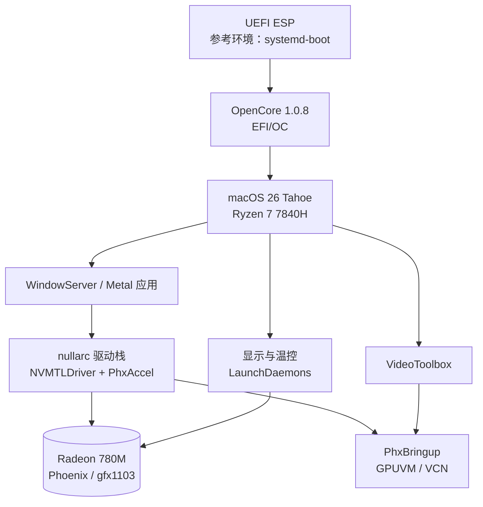

<p align="center">
  <b>机械革命 无界 S mini（F7BSC）· macOS 26 黑苹果</b><br>
  OpenCore EFI、安装后工具、驱动补丁与真机验证记录<br>
  AMD Ryzen 7 7840H · Radeon 780M · Phoenix / RDNA 3 · macOS Tahoe 26
</p>

<p align="center">
  <a href="README.md">English</a> ·
  <a href="README.zh-CN.md"><b>简体中文</b></a>
</p>

<p align="center">
  
  
  
  
  
  
  <a href="https://github.com/sfyyy/mechrevo-f7bsc-hackintosh/actions/workflows/docs.yml"></a>
  <a href="LICENSE"></a>
</p>

> [!IMPORTANT]
> **技术预览（M1）。** 当前仓库是同型号参考构建，不是普通用户可直接使用的一键安装包。现有流程假设你已经有安装好的 macOS、能够安全挂载并写入 EFI 系统分区（ESP）、能够下载外部文件，并具备修复引导故障的能力。Arch Linux 不是必需项，只是维护者当时的参考环境。**尚未完成面向普通用户的全新系统端到端安装验证。** 执行任何脚本前先阅读 [安装指南](docs/INSTALL.md)。

## 项目是什么

本项目记录并自动化一台特定迷你主机上的 macOS 26 Tahoe 部署：机械革命无界 S mini **F7BSC**，Ryzen 7 7840H 与 Radeon 780M。仓库包含 OpenCore EFI、安装后脚本、实验性 GPU 补丁、温控方案、诊断工具和真机验证证据。

重点方向是实验性的 [`nullarc`](https://github.com/luuumi-dev/nullarc) Radeon 780M 驱动栈：Metal、WindowServer GPU 合成、显示稳定性修复，以及 VideoToolbox/VCN 媒体能力。

## 项目目标

- 让同型号 F7BSC 能从清晰、可复现的基线完成部署。
- 让 GPU、显示、温控和媒体能力都有可重复的测量数据，而不只依赖主观描述。
- 为每项支持功能提供安全默认值、回退方式和验收清单。
- 明确区分原创内容与第三方二进制，并记录各自许可证。
- 最终让有经验的使用者在同型号机器上无需维护者介入即可安装和恢复。

**非目标：** 通用黑苹果 EFI、零风险安装器、其他笔记本/迷你主机适配，或宣称已达到生产环境稳定性。

## 功能状态

| 模块 | 状态 | 说明 |
|---|---|---|
| OpenCore EFI | F7BSC 可用 | OpenCore 1.0.8、macOS Tahoe 启动路径、SMBIOS 为占位值 |
| CPU 电源管理 | 可用 | AMD Vanilla 补丁 + AMDRyzenCPUPowerManagement，`ryzenidle=1` |
| Radeon 780M 加速 | 实验性 | nullarc 0.4.0，Metal 3 与 WindowServer GPU 合成 |
| 显示稳定性 | 实验性 | 双缓冲与动画残影绕过 LaunchDaemon；仅 HDMI |
| HDMI 输出 | 可用但有限 | 固件 GOP 模式 2560×1440@60；无 HiDPI |
| Intel AX210 Wi-Fi | 可用 | AirportItlwm 2.4.0 |
| Intel AX210 蓝牙 | 实验性 | 已安装固件和补丁，完整验收记录仍不充分 |
| Realtek RTL8125 有线网卡 | 已配置，未独立验证 | 驱动已启用，但尚未单独验收 |
| Realtek ALC269VB 声卡 | 已配置，未独立验证 | AppleALC layout 11 + SimpleHDA，尚未单独验收 |
| 温控 | 实验性 | 核显限频与时钟门控 LaunchDaemon |
| H.264 编码 | 实验性 | 进程内 VideoToolbox provider，不是通用系统级编码器 |
| H.264 VCN 硬解 | 实验性 | build 75 实时 1080p 单核 CPU 降低 41%；见 [性能记录](macos/nullarc/nullarc-0.4.0-alpha/docs/vcn/BENCHMARKS.md) |
| HEVC 硬件编解码 | 未实现 | 尚无受支持的 VCN HEVC 路径 |
| 诊断与回归测试 | 可用 | 状态检查、VCN 主机测试、VideoToolbox 与性能工具 |

## 普通用户能按文档安装成功吗？

| 用户与起点 | 支持等级 | 当前现实 |
|---|---|---|
| F7BSC 用户、高级用户、已有 macOS 且能访问 ESP | **实验性** | 可按当前指南操作，但必须准备备份与恢复盘，并接受手动排错 |
| F7BSC 用户从裸机全新安装 | **尚不支持** | BIOS 设置、安装介质制作和磁盘准备尚未形成完整流程 |
| 其他笔记本或迷你主机用户 | **不支持** | 不要复用此 EFI 或补丁 |
| 没有第二台电脑和恢复手段的新手 | **不支持** | 应等待 M2/M3 里程碑 |

文档只有在“同型号机器从零开始、无需维护者介入即可完成 BIOS 前置设置、macOS 安装、外部文件获取、功能验收与回退”时才可称为成熟。该验收门槛记录在 [路线图](ROADMAP.md)。

## 系统架构



## 仓库结构

| 路径 | 用途 |
|---|---|
| [`EFI/`](EFI) | OpenCore EFI、ACPI、驱动与可再分发的 kext |
| [`ACPI/`](ACPI) | 可读的 SSDT 源码 |
| [`linux/`](linux) | EFI 部署辅助脚本；只在维护者的 Arch + systemd-boot 环境实测，并非 Arch 专用设计 |
| [`macos/display/`](macos/display) | 显示稳定性 LaunchDaemon 与安装器 |
| [`macos/thermal/`](macos/thermal) | 核显限频与时钟门控 |
| [`macos/nullarc/`](macos/nullarc) | nullarc 安装包装（zip 加补丁流程）与历史补丁 |
| [`macos/nullarc/nullarc-0.4.0-alpha/`](macos/nullarc/nullarc-0.4.0-alpha) | 本项目维护的 nullarc 源码：PhxAccel、NVMTL、含 VCN H.264 硬解的 PhxBringup（build 82）、解码插件、安装脚本与测试 |
| [`macos/nullarc/nullarc-0.4.0-alpha/docs/vcn/`](macos/nullarc/nullarc-0.4.0-alpha/docs/vcn) | VCN/VideoToolbox 验收、基准与技术记录 |
| [`macos/nullarc/nullarc-0.4.0-alpha/tools/perf/`](macos/nullarc/nullarc-0.4.0-alpha/tools/perf) | WindowServer、CoreAnimation 和 GPU 性能工具 |
| [`macos/nullarc/nullarc-0.4.0-alpha/tests/macos/`](macos/nullarc/nullarc-0.4.0-alpha/tests/macos) | 复现与回归测试 |
| [`docs/INSTALL.md`](docs/INSTALL.md) | 当前支持的安装路径、前置条件与恢复方式 |
| [`docs/README.md`](docs/README.md) | 文档索引 |
| [`docs/known-issues.md`](docs/known-issues.md) | 详细问题历史与根因记录 |
| [`THIRD_PARTY_NOTICES.md`](THIRD_PARTY_NOTICES.md) | 第三方许可证与源码出处 |

## 开始之前

1. 确认机器确实是受支持的 F7BSC。
2. 准备完整备份、可启动恢复环境和第二台电脑。
3. 阅读 [安装指南](docs/INSTALL.md)，包括当前缺失的全新安装前置条件和回退步骤。
4. 按文档中的固定校验值下载外部组件。
5. 部署 EFI、应用安装后补丁，只在文档要求时重启，并完成验收清单。

不要直接从脚本开始。当前路径面向同型号高级用户，不是一键安装器。

## 验收入口

每个主要阶段后运行只读状态检查：

```sh
sudo bash macos/check.sh
```

受支持构建至少应证明：

- macOS 版本符合预期，且拔掉恢复 U 盘后仍能正常启动。
- `PhxAccel`/`NMXAccel` 与 WindowServer GPU 合成已生效。
- HDMI 在记录的显示模式下稳定，没有持续撕裂或残影。
- Wi-Fi 可用；蓝牙、有线网卡和声卡均经过单独测试，而不是默认认为可用。
- 温控服务已加载，轻度 GPU 负载下系统稳定。
- H.264 VideoToolbox 编解码结果符合文档中的限制。

媒体证据见 [BENCHMARKS.md](macos/nullarc/nullarc-0.4.0-alpha/docs/vcn/BENCHMARKS.md)、[NEXT.md](macos/nullarc/nullarc-0.4.0-alpha/docs/vcn/NEXT.md) 和 [known-issues.md](docs/known-issues.md)。

## 当前限制

- 无 HiDPI，也不支持更多外接显示器。
- 蓝牙、有线网卡和声卡仍缺少独立验收记录。
- H.264 能力为实验性，HEVC 硬件编解码尚未完成。
- GPU 驱动依赖上游 alpha 项目和本地补丁。
- 现有的 Linux 部署脚本只在 Arch Linux + systemd-boot 上验证过；其他发行版或手动写入 ESP 仍未完成验收。
- GPU 路径失败时登录窗口可能黑屏，因此必须先准备恢复方式。
- 不同 BIOS 版本和硬件批次可能改变设备路径、内存布局或支持模式。

## 路线图

- **M1 — 文档与仓库基线：** 许可证、双语 README、贡献规则、模板、仓库元数据和明确的支持范围。
- **M2 — 可复现全新安装：** BIOS 清单、安装介质、磁盘布局、固定版本、验收与回退，并从零测试两次。
- **M3 — 稳定的同型号发布：** 睡眠/唤醒、全部 I/O、长时间稳定性与新手可执行清单。
- **M4 — 媒体与性能：** VCN 会话复用、fence 等待优化、HEVC 调研和多路持续播放验收。
- **M5 — 扩展硬件：** 只有同型号流程真正成熟后才考虑。

任务、优先级与验收标准见 [ROADMAP.md](ROADMAP.md)。

## 参与贡献

问题报告应包含确切的硬件型号、BIOS 版本、macOS build、已安装组件、复现步骤，以及是否测试过恢复。不要公开 SMBIOS 序列号、MLB、UUID 或 Apple 账号信息。

提交 Pull Request 前请阅读 [CONTRIBUTING.md](CONTRIBUTING.md)。社区支持为尽力而为；不受支持的硬件可能无法获得排错帮助。提问前需要提供的信息见 [SUPPORT.md](SUPPORT.md)。

## 安全

本项目会修改引导器、内核扩展和系统目录。执行前检查脚本并保留离线备份。安全问题请按 [SECURITY.md](SECURITY.md) 私下报告。

## 许可证

本仓库的原创文档、脚本与配置采用 MIT License，见 [LICENSE](LICENSE)。第三方二进制、上游源码和补丁衍生部分遵循各自许可证，见 [THIRD_PARTY_NOTICES.md](THIRD_PARTY_NOTICES.md)。仓库不再分发 Apple 软件或无法公开分发的第三方 kext。

## 致谢

感谢 Linux `amdgpu` 团队、Mesa/RADV 贡献者、[nullarc](https://github.com/luuumi-dev/nullarc)、Acidanthera/OpenCore，以及文档中引用的各 Hackintosh 项目。本项目与 Apple、AMD、机械革命及 nullarc 均无隶属关系。
